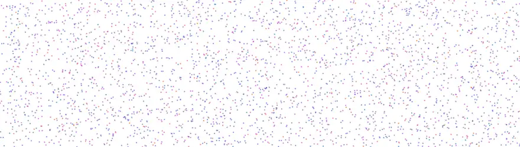
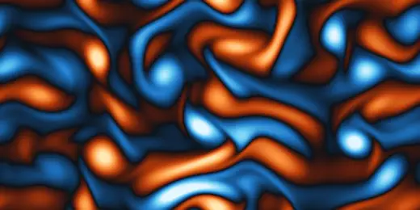

<picture>
  <source media="(prefers-color-scheme: dark)" srcset="assets/hero-dark.webp">
  <source media="(prefers-color-scheme: light)" srcset="assets/hero-light.webp">
  
</picture>

### hey, i'm shyaam 👋

love immersive problems relating to computational modelling :)

stuff i'm working on rn:

<table>
<tr>
<td width="50%" valign="top">
 
<a href="https://github.com/IDZTPHKKKS/go2-fall-risk"><b>go2-fall-risk</b></a>: do world models know when a robot dog is about to fall? (spoiler: they're way too optimistic)
</td>
<td width="50%" valign="top">
 
<a href="https://github.com/IDZTPHKKKS/Sybil4Drones"><b>Sybil4Drones</b></a>: one hacked drone spawns fake teammates and messes up everyone's map. also how to catch it
</td>
</tr>
<tr>
<td width="50%" valign="top">
 
<a href="https://github.com/IDZTPHKKKS/reynolds-grid-study"><b>reynolds-grid-study</b></a>: trained 200+ neural nets on turbulence to see where they break
</td>
<td width="50%" valign="top">
 
<a href="https://github.com/IDZTPHKKKS/cfdml"><b>cfdml</b></a>: small cli tools for poking at cfd results
</td>
</tr>
</table>

[linkedin](https://www.linkedin.com/in/shyaam-mahesh-7b8341261/) · [chess](https://ratings.fide.com/profile/35054074)
