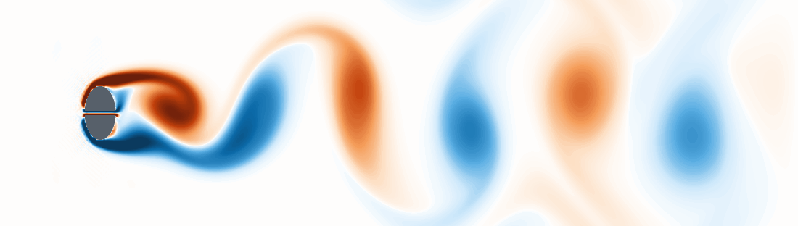

<picture>
  <source media="(prefers-color-scheme: dark)" srcset="assets/flow-dark.gif">
  <source media="(prefers-color-scheme: light)" srcset="assets/flow-light.gif">
  
</picture>

<h1 align="center">Shyaam Mahesh</h1>

  <b>Flows &nbsp;·&nbsp; Neural surrogates &nbsp;·&nbsp; Robots that have to trust them</b> 
  M.Tech, Robotics &amp; Autonomous Systems, IISc Bengaluru &nbsp;|&nbsp; B.E. Mechanical, BITS Pilani

  
  
  

 

I started out running CFD and checking every number against experiment. Then I started training neural networks on that data, and the question changed: can a model learn a physical system well enough that you stop simulating and trust the model instead? These days I ask the robotics version of it, **how a robot should plan and act with learned models when it cannot know in advance where their predictions will fail.**

 

## Featured work

<table>
<tr>
<td width="50%" valign="top">

<h3><a href="https://github.com/IDZTPHKKKS/go2-fall-risk">Will It Fall?</a></h3>
Do diffusion and flow-matching world models know how often a robot falls? I fork a Unitree Go2 simulation 128 ways at each state to get the true answer. They underestimate the risk, and a coarse-to-fine model fixes most of it.
  
<code>PyTorch</code> <code>MuJoCo</code> <code>world models</code>
</td>
<td width="50%" valign="top">

<h3><a href="https://github.com/IDZTPHKKKS/Sybil4Drones">Sybil4Drones</a></h3>
One compromised drone creates fake teammates that claim frontiers and send fabricated scans. The defences use only each drone's own sensors. Tested in 2,350 missions on 70 maps. <a href="https://arxiv.org/abs/2610.33906">arXiv</a>
  
<code>multi-robot</code> <code>3D mapping</code> <code>security</code>
</td>
</tr>
<tr>
<td width="50%" valign="top">

<h3><a href="https://github.com/IDZTPHKKKS/cfdml">cfdml</a></h3>
Command-line tools for CFD results: spectra, POD, DMD, grid convergence, Gaussian-process surrogates, and checks for long learned rollouts. Works on OpenFOAM cases, CSV and VTK.
  
<code>OpenFOAM</code> <code>POD / DMD</code> <code>surrogates</code>
</td>
<td width="50%" valign="top">
<h3><a href="https://github.com/IDZTPHKKKS/reynolds-grid-study">Reynolds × grid study</a></h3>
Over 200 FNO, U-Net and CNN surrogates trained on forced 2D Kolmogorov turbulence, each tested on every other Reynolds number and grid. The results were lopsided:
  
<table>
<tr><td>Re 32× higher than training</td><td>✅ holds up</td></tr>
<tr><td>Re 8× lower than training</td><td>❌ worse than "nothing changes"</td></tr>
</table>
The models don't remove energy fast enough, and telling them the viscosity doesn't fix it.
  
<code>FNO</code> <code>U-Net</code> <code>turbulence</code>
</td>
</tr>
</table>

## Papers

- **M. Shyaam**, P. Vishnuraj, K. K. Vijesh, S. Vengadesan. *Qualitative and quantitative analysis of wake dynamics in slotted elliptical cylinders for non-Newtonian fluids.* **Physics of Fluids** 38, 073110 (2026).
- **S. Mahesh**, A. B. Prakash, R. Sagwal, A. Gautam. *Sybil-Resilient Multi-Drone Exploration of Indoor and Confined Spaces.* [arXiv:2610.33906](https://arxiv.org/abs/2610.33906) (2026).
- S. Bhattacharyya, B. Souayeh, **S. Mahesh**, S. Khatri, N. K. Almulhem, M. W. Alam. *Vibration-assisted thermal performance enhancement of rectangular cooling channels using Fe₃O₄–TiO₂ hybrid nanofluid for EV battery cooling.* Accepted, **International Journal of Modern Physics B** (2026).

## Toolbox

  
  
  
  
  
  
  
  
  
  

 

The header is a lattice-Boltzmann simulation of flow past a slotted elliptical cylinder, the shape from my first paper. It is rendered by <a href="assets/lbm_banner.py"><code>assets/lbm_banner.py</code></a>. Away from the screen I play chess (FIDE 1708).
